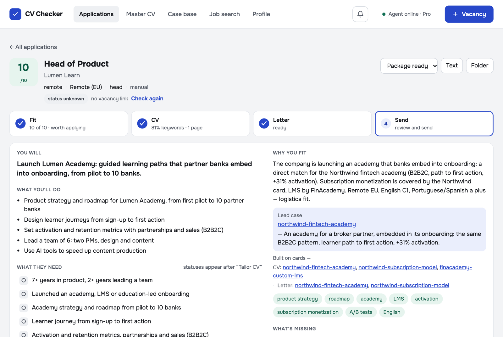
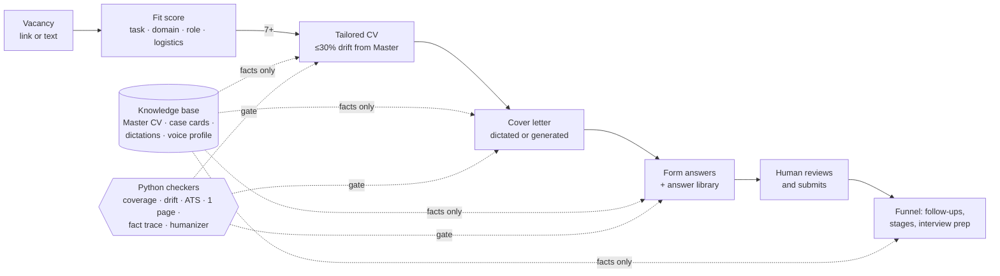
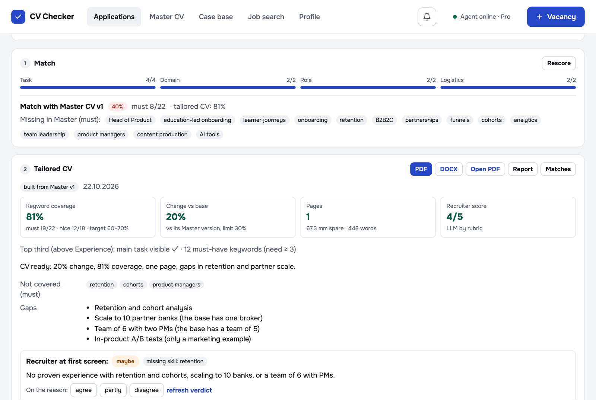
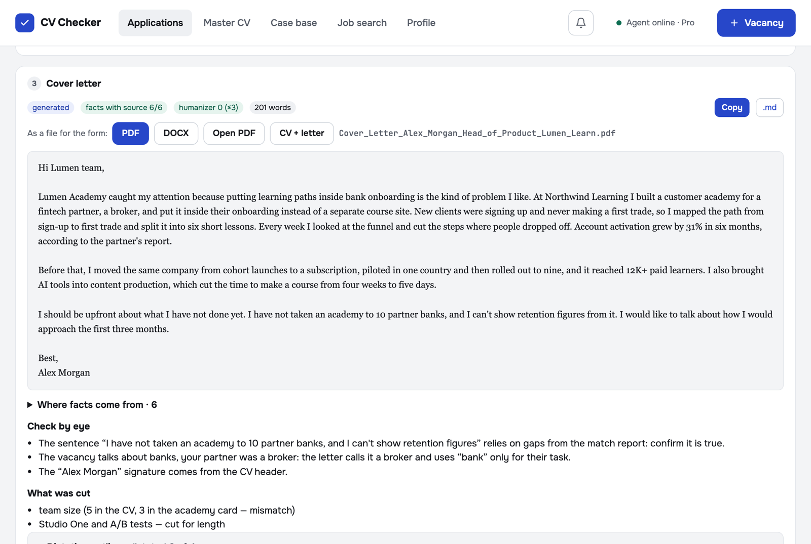
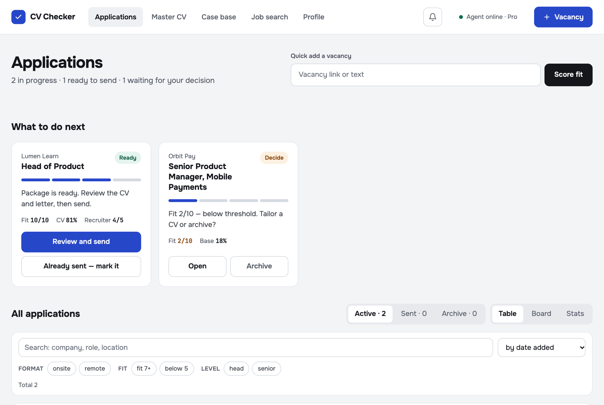
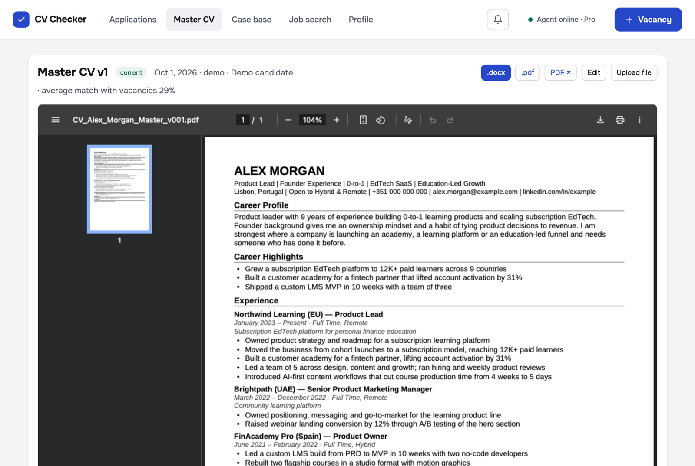

# CV Checker

**An agentic job-application copilot built on Claude Code.** You paste a vacancy. It scores the fit, tailors a one-page ATS CV,
writes or assembles a cover letter, prepares form answers and interview stories, and tracks the funnel.
Every claim comes from a verified knowledge base of your own experience. The human reviews and clicks Submit.



> Built by a product lead for a real job search and used daily on real applications.
> This repository runs on a **fictional demo candidate (Alex Morgan)**. Real personal data lives in a separate private repo.
> The UI, specs and agent instructions are in Russian; this README, the CVs and the letters are in English.
> Screenshots show the demo candidate with on-screen text translated to English for this page.

## The problem

Applying well is slow. Each good application needs a CV adjusted to the role, a letter that sounds like you, answers to form
questions, and a follow-up plan. Generic AI tools make this faster but worse. They invent achievements and over-stuff keywords,
and the result sounds like everyone else.

Two observations shaped the product:

1. **Fit is about the task, not the industry.** Every past hire of the author happened when a company was about to build
   something the author had already built (a learning academy or an LMS), and the industry was different each time.
   So scoring weighs the task first. It also looks for non-education companies that start building education,
   because those rarely post a matching role.
2. **Trust is the bottleneck.** Every line has to be defensible in an interview, otherwise the speed is worthless.
   Every generated fact is traced to a source file, and scripts (not the model) check the result.

## How it works



- **Agents** run headless, one per task (`claude -p --output-format stream-json`). Each task follows a project skill in
  `.claude/skills/`, and you choose the model per task (Sonnet by default, Haiku where a script verifies the output).
- **Checkers** in `scorer/` are deterministic Python. They score keyword coverage (must/nice), drift from the Master CV,
  page count via a real LibreOffice render, ATS structure, the share of the letter taken from the dictation, the source of
  every fact in a generated letter, and AI-sounding phrasing.
- **Web app** in `web/` is Express plus vanilla JS on localhost. It shows a live agent log over SSE and a per-task cost
  journal. It has a pipeline view, a board and stats.

## Key design decisions

| Decision | Why |
|---|---|
| Facts only from the knowledge base; gaps go to a report, never into the CV | A tailored CV you can't defend in an interview is worse than a generic one |
| CV may change at most 30% vs the Master CV; title line = exact role name | Keeps one consistent professional story across applications |
| Coverage target 60–70%, not 100% | Keyword-stuffed CVs read badly; data suggests 40–60% match performs best |
| Two letter paths: ≥80% of words from your own dictation, *or* generated with every sentence traced to a source file + a voice profile | Your voice where it matters, speed where it doesn't, invented facts on neither path |
| The agent never submits, sends or fills gender/race/consent fields | Human in the loop at every irreversible step |
| Soft monthly budget, cheaper model per task, answer library reuse | Agent cost is a product metric, not an afterthought |
| Every feature started as a spec with goals, non-goals and P0/P1 (`docs/specs/`) | 30 features shipped one at a time: spec → approve → build → verify |

## Features

Fit and sourcing:
- Fit scoring by a 10-point rubric, with hard filters from your search profile. The rubric is calibrated on reference vacancies.
- A job feed from public boards, plus **EdTech and FinTech company career pages** collected through open ATS APIs
  (Greenhouse, Lever, Ashby, Workable, SmartRecruiters, Recruitee, Personio). It also flags companies that start
  building an academy without a product lead.
- A "Still open?" check before any paid step, and target companies with an outreach draft.

The application package:
- A tailored CV (`.docx` and `.pdf`, one page, ATS format) with a match report, gaps, and a recruiter verdict:
  yes, no or maybe, with one main reason.
- A cover letter from dictation (voice input) or generated with a fact trace. Export to PDF and DOCX; you can revert to the
  previous letter.
- Form answers, with an answer library that skips the agent for questions you have answered before.
- A Playwright form autofill that never clicks Submit.

The funnel:
- Sent tracking with follow-ups, a board, stats by fit, channel and stage, and a rejection log that separates facts
  from your own version of the reason.
- Interview prep: a "Tell me about yourself" draft, a STAR story bank from your case cards, and a voice trainer that
  scores answers 1–4.
- Offer numbers: target, anchor and walk-away, with mismatch alerts. A weekly plan measures actions, not offers.

Full list with specs and status: [`docs/specs/README.md`](docs/specs/README.md).

<table>
<tr><td></td>
<td></td></tr>
<tr><td></td>
<td></td></tr>
</table>

## Results

- The author has used it on real applications since September 2026.
- An average application package costs about **$2.5** in model usage, measured over 20 real packages and priced at API rates.
  It takes about 6 minutes of agent time.
- On the demo vacancy shown here, the agent work cost **$1.81**: fit $0.45, CV $0.58, letter $0.37, plus $0.41 to score
  a second vacancy.
  - The CV covers 81% of the vacancy's keywords (19 of 22 must-haves) at 20% drift from the Master CV, on one page.
  - All 6 facts in the letter trace back to a source file.
- The smoke suite runs 766 read-only checks across the API, file downloads and calibration. It does not call the agent.

## Run it locally

Requirements:
- Node 20+
- Python 3.11+
- LibreOffice (`soffice` in PATH), used for PDF rendering and page counts
- [Claude Code](https://docs.claude.com/claude-code) CLI, logged in

```bash
git clone https://github.com/rotovvitalii-sudo/CV_Checker.git && cd CV_Checker
npm install
python3 -m venv .venv && .venv/bin/pip install -r requirements.txt
claude auth login
npm run demo:setup    # copies the fictional demo candidate into place
npm run app           # http://127.0.0.1:4317
```

To use it for yourself, replace `knowledge-base/` with your own Master CV and case cards. The `case-interview` skill
builds the cards from your dictations. Your personal folders are git-ignored. `npm run check:public` scans files before
you publish, and `npm run backup:data` backs up your data to a separate private repo.

## Repository map

| Path | What |
|---|---|
| `.claude/skills/` | 12 agent skills: tailor-cv, cover-letter, cover-letter-generate, letter-outline, humanizer, job-scout, form-answers, interview-prep, case-interview, outreach, voice-profile, edtech-companies |
| `web/` | Express server, agent runner, prompts, UI (`web/public/`) |
| `scorer/` | Deterministic checkers and builders (Python) |
| `job-search/` | Job fetchers, role dictionary, calibration fixtures |
| `docs/specs/` | 30 feature specs (PRD format, Russian) |
| `examples/demo/` | Fictional candidate: knowledge base, vacancies, one finished package |
| `tests/smoke.py` | Whole-app smoke test |

## License

MIT
